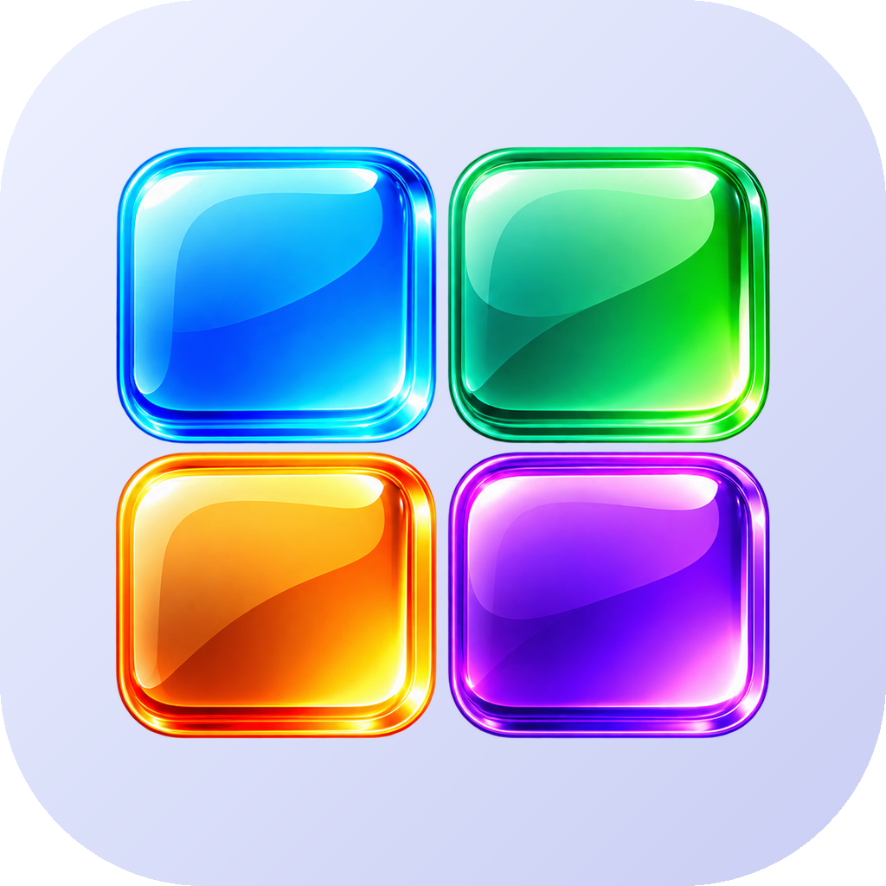

# OpenDesktop



Otwarty, rozbudowany launcher (ekran główny) na Androida, napisany w Kotlinie i Jetpack Compose.

## Pulpit

- **Siatka do ustawienia** — od 3 do 10 kolumn i od 3 do 12 wierszy; zmiana układu przenosi elementy, które się nie mieszczą, na kolejne ekrany.
- **Ikony, foldery i widżety** — przytrzymaj i przeciągnij; upuść aplikację na aplikację, a powstanie folder.
- **Plakietki powiadomień** — liczba oczekujących powiadomień w rogu ikony na pulpicie, w doku, w folderach i w szufladzie (wymaga dostępu do powiadomień; przełącznik w Ustawieniach → Wygląd → Ikony).
- **Nakładanie się** — elementy mogą na siebie zachodzić albo trzymać się wolnych komórek (przełącznik w ustawieniach).
- **Zmiana rozmiaru** — uchwyt w rogu zaznaczonego elementu w trybie edycji (dotyczy widżetów, folderów i ikon).
- **Wiele ekranów** — dodawanie, usuwanie, zmiana kolejności i wybór ekranu głównego. Przytrzymanie elementu przy krawędzi przenosi go na sąsiedni ekran albo tworzy nowy.
- **12 przejść między ekranami** — przesunięcie, sześcian, sześcian od środka, głębia, oddalenie, przenikanie, wachlarz, odwracana karta, stos kart, karuzela 3D, akordeon, fala.
- **Widżety systemowe i wbudowane** — zegar z datą i baterią, pasek wyszukiwania oraz ponad 20 własnych widżetów (zegary, kalendarz, bateria, odliczanie, notatka, faza Księżyca, rok w kropkach…).
- **Pogoda** (Open-Meteo, bez klucza) — bieżąca, prognoza do 16 dni (kolumny, lista z paskami zakresu, wykres, kompakt), prognoza godzinowa do 48 h (wykres z opadami, kolumny, lista), pełny panel, kafelki szczegółów (wiatr z kierunkiem, wilgotność, ciśnienie, UV, opady, zachmurzenie, słońce) i łuk drogi słońca. Miasto albo współrzędne, jednostki °C/°F, km/h, m/s, mph, węzły, hPa/mmHg/inHg.
- **Dostosowanie widżetów** — stały podgląd i cztery karty: treść, wygląd (16 gotowych stylów, gradienty, obrys, cienie, kopiowanie wyglądu między widżetami), kolory (własny kolor HSV lub hex) i tekst (5 krojów, 6 grubości). Dla pogody: tło zależne od warunków, kolorowe temperatury, ikony akcent/kolorowe/emoji, wielkość ikon.
- **Dok** — od 3 do 7 miejsc; przeciąganie między dokiem a pulpitem.
- **Gesty** — przesunięcie w górę, w dół i podwójne dotknięcie z akcjami do wyboru.
- **Strefy upuszczania** — usuń, informacje, odinstaluj.
- **Cofanie** — po usunięciu ikony, folderu, widżetu albo ekranu przez pięć sekund widać nad dokiem „Cofnij”; widżet wraca działający, bo z hosta znika dopiero po tym czasie.

## Szuflada aplikacji

11 motywów: siatka, lista, strony poziome, alfabet z szybkim przewijaniem, zakładki kategorii, kafelki, karuzela 3D, helisa 4D, kula 3D, koło do obsługi jedną ręką oraz bąbelki (plaster miodu z efektem soczewki).

- Sortowanie po nazwie, kategorii, częstości użycia lub dacie instalacji.
- Wyszukiwanie po nazwie, pakiecie i kategorii; Enter uruchamia pierwszy wynik; szukanie w sieci.
- Szybkie odpowiedzi nad wynikami: kalkulator („12*7+3”) i przeliczanie jednostek („10 km na mi”, „72 f to c”), kliknięcie kopiuje wynik do schowka.
- Kontakty z książki adresowej i ekrany ustawień systemowych pod wynikami aplikacji; kontakt otwiera wizytówkę, ustawienie – odpowiedni ekran Androida. O dostęp do kontaktów pytamy przy pierwszym wyszukiwaniu, a bez zgody sekcja jest po prostu pomijana.
- Oba źródła wyników można wyłączyć w Ustawieniach → Szuflada aplikacji („Szybkie odpowiedzi”, „Kontakty w wynikach”).
- Filtr kategorii, ukrywanie aplikacji, zmiana nazw, skróty aplikacji (gdy OpenDesktop jest domyślny).
- Kategorie: aplikacja może należeć do jednej albo wielu; tworzenie ręczne, automatyczne (bez AI) lub przez AI.

## AI (OpenRouter)

Wklej klucz z [openrouter.ai/keys](https://openrouter.ai/keys) i wybierz model z pełnej listy pobranej z API (wyszukiwanie, filtr darmowych modeli, ceny, długość kontekstu). AI potrafi:

- zbudować spersonalizowane kategorie z listy aplikacji według Twoich wskazówek,
- znaleźć aplikację po opisie („czym zapłacę za parking?”),
- zaproponować nazwę folderu.

Klucz zostaje na urządzeniu i nie trafia do kopii zapasowej.

## Aktualizacje

Każdy wypchnięty tag `vX.Y.Z` buduje podpisane APK i publikuje wydanie w GitHub Releases. Aplikacja sama sprawdza najnowsze wydanie wskazanego repozytorium (domyślnie `BlackSingularities/OpenDesktop`; w ustawieniach można je wyszukać na GitHubie), pobiera APK i przekazuje je do instalatora systemowego.

## Budowanie

```bash
gradle :app:assembleRelease
```

Wymagane: JDK 17, Android SDK 35, Gradle 8.11. Podpis wydań pochodzi z sekretów repozytorium `SIGNING_*`; bez nich APK jest podpisane kluczem debug.

## Zasoby graficzne

Zdjęcie Księżyca (`app/src/main/res/drawable-nodpi/moon_photo.webp`) powstało z kadru
[FullMoon2010.jpg](https://commons.wikimedia.org/wiki/File:FullMoon2010.jpg) autorstwa Gregory’ego H. Revery,
na licencji [CC BY-SA 3.0](https://creativecommons.org/licenses/by-sa/3.0/); tło zostało wycięte, a obraz przeskalowany.

---

**Projekt i wykonanie: [redzikowski.com](https://redzikowski.com)**

<a href="https://buycoffee.to/adamredzikowski" target="_blank"></a>
